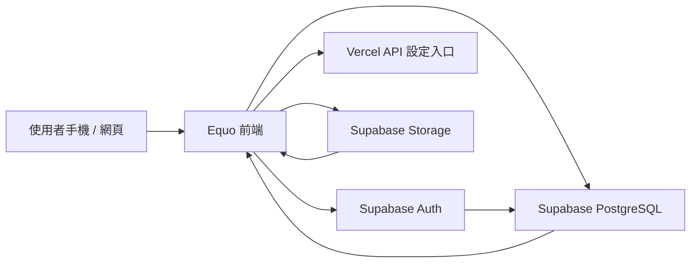

# Equo 算好 系統設計文件 SDD

## 1. 文件目的

本文件定義 Equo 算好從展示原型走向可長期經營產品時的系統設計方向。產品使用情境以手機為主，預估 90% 使用行為發生在手機上，因此所有核心流程都以手機版體驗優先設計，網頁版則作為快速試用、桌面檢視、管理與客服支援入口。

## 2. 產品範圍

Equo 算好是一款多人分帳工具，協助朋友、旅遊、家庭、室友與活動群組記錄支出、自動分攤、追蹤付款狀態並完成結算。

核心目標：

- 讓使用者能在手機上快速完成新增支出。
- 讓群組成員清楚知道自己要付誰、收誰、是否已完成付款。
- 讓邀請、權限、備份與跨裝置接續使用穩定可靠。
- 讓未來可以逐步加入照片收據、付款提醒、訂閱方案與正式 App。

## 3. 使用平台定位

### 3.1 手機版

手機版是主要產品體驗，占預估使用量 90%。

設計原則：

- 首頁直接顯示目前應收、應付、群組與最近支出。
- 常用操作放在底部導覽或底部彈窗內，符合單手操作。
- 新增支出、成員管理、邀請連結、付款確認都必須能在小螢幕完成。
- 彈窗採底部 sheet，不使用桌面式大型 modal。
- 表單欄位盡量分段，避免一頁塞滿過多資訊。
- 夜間模式、字體大小、對比與觸控範圍優先檢查。
- 初期可先做 PWA 手機網頁，後續再封裝成 iOS / Android App。

手機版核心流程：

1. 登入或快速試用。
2. 建立群組。
3. 邀請成員。
4. 新增支出。
5. 查看誰該付誰。
6. 標記付款完成。
7. 備份與跨裝置接續使用。

### 3.2 網頁版

網頁版是輔助入口，占預估使用量 10%。

設計原則：

- 先支援桌面瀏覽與平板瀏覽，不作為主要操作場景。
- 適合展示產品、查看較完整的報表、匯出資料、管理帳號與客服除錯。
- 可以保留較寬的資訊密度，但互動邏輯必須與手機版一致。
- 網頁版不應出現手機版沒有的核心能力，避免兩端體驗落差。

網頁版核心流程：

1. 產品試用與登入。
2. 查看所有群組與報表。
3. 匯出 CSV / HTML / 未來 PDF。
4. 管理備份、資料重設與帳號。
5. 供內部測試者或客服協助確認資料狀態。

## 4. 系統架構

### 4.1 目前架構

目前專案為單頁式網頁原型：

- 前端：`index.html`
- 部署：Vercel
- 資料：瀏覽器 localStorage 加 Supabase 資料表逐步接入
- 後端設定：Vercel API route 提供前端 Supabase 設定
- 資料庫：Supabase PostgreSQL
- 認證：Supabase Auth

目前架構適合快速展示與早期用戶測試，但若要長期經營，建議逐步拆分前端、資料層與權限層。

### 4.2 目標架構

目標架構：

- Mobile-first PWA：主要使用體驗。
- Responsive Web：桌面與平板輔助入口。
- Supabase Auth：Email / Google / Apple 登入。
- Supabase PostgreSQL：保存群組、成員、支出、付款與邀請。
- Supabase RLS：限制不同帳號只能看到自己參與的群組資料。
- Supabase Storage：保存收據、發票、頭像與未來附件。
- Vercel：前端部署、設定 API、未來輕量 serverless endpoint。

高階流程：

## 5. 前端設計

### 5.1 UI 設計方向

整體視覺維持 iOS 液態毛玻璃風格：

- 半透明卡片。
- 背景模糊。
- 細緻邊框。
- 柔和陰影。
- 深色與淺色模式。
- 底部導覽。
- 手機底部 sheet。

需避免：

- 過多技術用語。
- 桌面系統感太強的確認框。
- 太小的按鈕。
- 需要橫向捲動才能完成主要流程。
- 用戶不需要知道的工程檢查文字。

### 5.2 手機版版面

主要區塊：

- 首頁摘要：淨額、待付款、待收款。
- 群組清單。
- 待辦提醒。
- 最近支出。
- 底部導覽：首頁、群組、新增、統計、我的。
- 新增支出 sheet。
- 群組設定 sheet。
- 邀請成員 sheet。
- 刪除確認 sheet。

手機尺寸要求：

- 375px 寬度可完整操作。
- 390px / 430px iPhone 尺寸優先檢查。
- 觸控按鈕高度建議不低於 44px。
- sheet 開啟時背景不可捲動。
- sheet 標題區固定，避免內容太長時找不到關閉按鈕。

### 5.3 網頁版版面

主要區塊：

- 左側或頂部導覽可在未來擴充。
- 群組與報表可使用較寬的雙欄排版。
- 我的頁可放更多帳號、匯出、備份資訊。
- 桌面版仍應使用同一套資料與權限，不另做平行邏輯。

## 6. 功能模組

### 6.1 帳號與個人資料

功能：

- Email 登入。
- Google 登入。
- Apple 登入。
- 登出。
- 個人名稱。
- 人形頭像或帳號照片。
- 預設幣別。
- 備份狀態。

手機優先重點：

- 登入頁簡短。
- 快速試用明確。
- 頭像選擇不使用複雜裁切流程，先提供人形樣式。

### 6.2 群組

功能：

- 建立群組。
- 修改群組名稱、類型、幣別。
- 刪除群組。
- 邀請成員。
- 管理成員角色。
- 查看群組支出與結算。

角色：

- 擁有者：完整管理權限。
- 管理員：可管理帳務與邀請。
- 家長：家庭模式中的管理者。
- 成員：可新增與查看一般帳務。
- 子女：只能看與自己相關的資料。
- 訪客：只可檢視。

### 6.3 支出

功能：

- 新增支出。
- 編輯支出。
- 刪除支出。
- 選擇付款人。
- 選擇參與分攤成員。
- 分類。
- 幣別。
- 備註。
- 未來支援收據照片。

分攤方式：

- 平均分攤。
- 指定成員。
- 權重分攤。
- 自訂金額。

金額規則：

- 儲存時以最小貨幣單位處理。
- 顯示時四捨五入到整數或指定小數。
- 無法整除的差額由系統分配到前幾位成員，總額必須等於原始支出。

### 6.4 結算與付款

功能：

- 自動計算每位成員淨額。
- 產生最少轉帳筆數。
- 標記付款完成。
- 確認收款。
- 付款提醒。
- 付款紀錄。

手機優先重點：

- 用「你要付給誰」與「誰要付給你」描述，不顯示太多公式。
- 付款按鈕清楚。
- 完成後立即更新待辦與淨額。

### 6.5 邀請

功能：

- 群組產生邀請連結。
- 設定受邀者預設角色。
- 登入後接受邀請。
- 邀請失效處理。
- 未來支援 QR Code。

安全規則：

- 邀請 token 不可猜測。
- 邀請連結需有有效期限。
- 已停用或刪除的群組不可加入。
- 角色不可超過邀請者本身權限。

### 6.6 備份與同步

功能：

- 登入後自動備份。
- 手動立即備份。
- 查看線上備份狀態。
- 載入備份。
- 清除範例資料。
- 清除本機資料。

產品文字原則：

- 對用戶顯示「備份、線上備份、接續使用」。
- 避免顯示 Supabase、資料表、RPC、RLS 等技術字眼。

## 7. 資料設計

### 7.1 主要資料表

建議資料表：

- `profiles`：使用者個人資料。
- `groups`：群組。
- `group_members`：群組成員與角色。
- `expenses`：支出。
- `expense_participants`：支出分攤成員。
- `settlement_statuses`：結算付款狀態。
- `payment_records`：付款紀錄。
- `group_invites`：邀請連結。
- `attachments`：收據、發票或附件。
- `audit_logs`：重要操作紀錄。

### 7.2 資料歸屬

原則：

- 每筆群組資料必須有擁有者。
- 每位成員都應有角色。
- 未登入試用資料只留在此裝置。
- 登入後資料保存到線上資料庫。
- 刪除群組時需同步刪除或封存相關支出、成員、結算紀錄。

### 7.3 權限規則

基本規則：

- 使用者只能讀取自己參與的群組。
- 使用者只能修改自己有權限操作的群組資料。
- 訪客不可新增、修改、刪除。
- 子女只能看與自己相關的支出與結算。
- 管理員與家長可管理支出與成員。
- 擁有者可刪除群組與移除成員。

## 8. 非功能需求

### 8.1 效能

手機體驗目標：

- 首頁首次可互動時間小於 2 秒。
- 常用操作回饋小於 300ms。
- 新增支出後立即更新畫面。
- 清單超過 100 筆時需加入分頁或虛擬列表。

### 8.2 穩定性

要求：

- 任何儲存失敗都要保留本機草稿。
- 備份失敗要顯示可理解提示。
- 網路不穩時不得讓使用者資料消失。
- 刪除操作必須二次確認。

### 8.3 安全性

要求：

- 不在前端保存 service role key。
- 使用 Supabase RLS。
- 邀請連結使用不可猜測 token。
- 敏感操作需檢查使用者角色。
- 未來收據照片需限制存取權限。

### 8.4 隱私

原則：

- 只收集完成分帳所需資料。
- 使用者可刪除本機資料。
- 使用者可刪除或離開群組。
- 匯出資料前需明確告知內容。

## 9. 測試策略

### 9.1 手機版測試

優先測試尺寸：

- iPhone SE 寬度。
- iPhone 13 / 14 / 15 常見寬度。
- 大螢幕手機。
- Android Chrome 常見寬度。

必測流程：

1. 快速試用。
2. 建立群組。
3. 新增成員。
4. 新增支出。
5. 刪除支出。
6. 刪除成員。
7. 刪除群組。
8. 邀請連結。
9. 登入後備份。
10. 夜間模式。

### 9.2 網頁版測試

必測流程：

1. 桌面登入。
2. 群組列表檢視。
3. 報表檢視。
4. 匯出資料。
5. 備份與載入備份。

### 9.3 資料測試

必測項目：

- 金額四捨五入。
- 多幣別換算。
- 刪除後結算重新計算。
- 同帳號跨裝置資料一致。
- 兩個帳號加入同一群組後權限一致。
- 子女與訪客看不到不該看到的資料。

## 10. 發布策略

### 10.1 第一階段：手機網頁可測試版

目標：

- Vercel 網頁版穩定。
- Supabase 保存真實多人資料。
- 手機操作完整。
- 文字去技術化。
- 測試者可用邀請連結加入。

### 10.2 第二階段：PWA

目標：

- 手機可加入主畫面。
- 加入 app icon。
- 加入離線草稿。
- 優化啟動畫面。
- 強化手機手勢與 sheet 體驗。

### 10.3 第三階段：原生 App 準備

目標：

- 評估 React Native、Expo 或 Capacitor。
- 重構目前單檔前端。
- 抽出共用資料邏輯。
- 加入正式推播與收據照片。

### 10.4 第四階段：正式營運

目標：

- 訂閱方案。
- 付款提醒。
- 匯出進階報表。
- 客服後台。
- 資料刪除與隱私流程。

## 11. 技術債與重構方向

目前技術債：

- 單一 `index.html` 會越來越難維護。
- 前端狀態、畫面渲染、資料同步邏輯混在一起。
- 測試流程仍偏手動。
- 表單與權限判斷需要抽出共用函式。

建議重構：

1. 拆出 `src/state` 管理使用者、群組、支出。
2. 拆出 `src/services` 管理 Supabase 讀寫。
3. 拆出 `src/ui` 管理 sheet、toast、confirm。
4. 拆出 `src/features` 管理群組、支出、結算、邀請。
5. 建立自動化測試，至少涵蓋新增支出、結算、刪除、邀請。

## 12. 交付檢查清單

手機版：

- 主要流程可單手完成。
- 所有底部 sheet 可關閉。
- 夜間模式文字可讀。
- 刪除確認符合 App 樣式。
- 頭像、成員、金額不互相擠壓。
- 低寬度螢幕沒有文字溢出。

網頁版：

- 桌面寬度不顯得過空或過擠。
- 報表與匯出入口清楚。
- 帳號、備份、資料管理入口清楚。

資料：

- 登入後不載入範例資料。
- 清除範例入口清楚。
- 備份失敗有提示。
- 多人同步一致。
- 權限限制正確。

## 13. 後續建議優先順序

建議下一步：

1. 補 PWA 基礎設定，讓手機可加入主畫面。
2. 整理手機版新增支出流程，減少欄位壓迫。
3. 把群組與支出資料完全雲端化並補自動化測試。
4. 強化受邀成員權限顯示與限制。
5. 規劃正式 App 重構路線。
